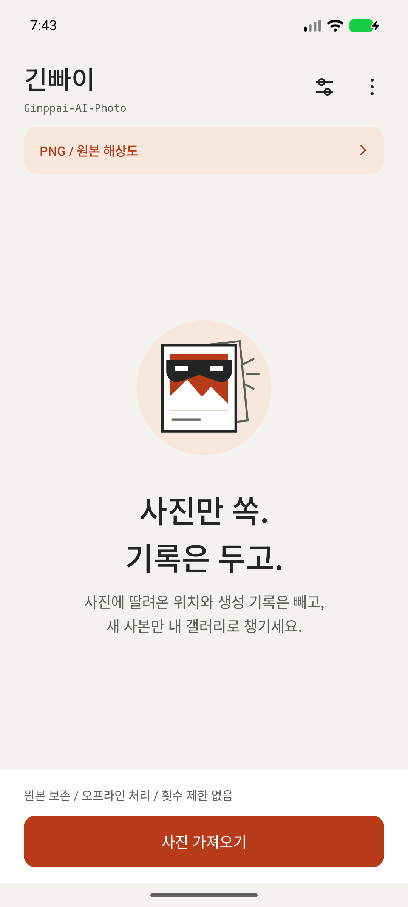
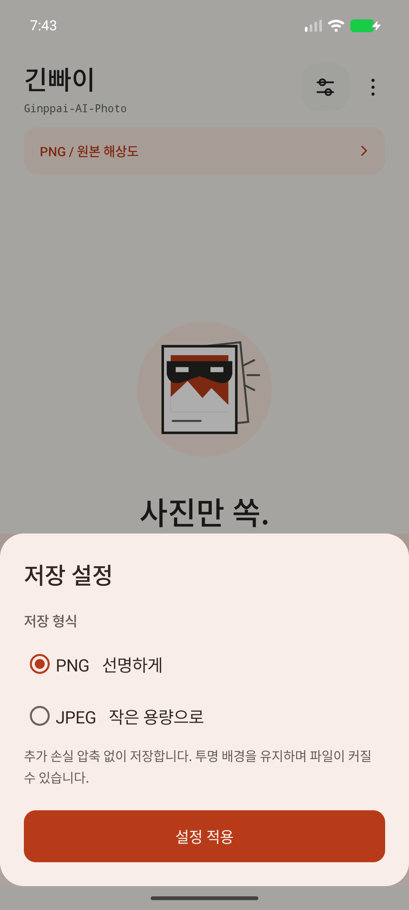
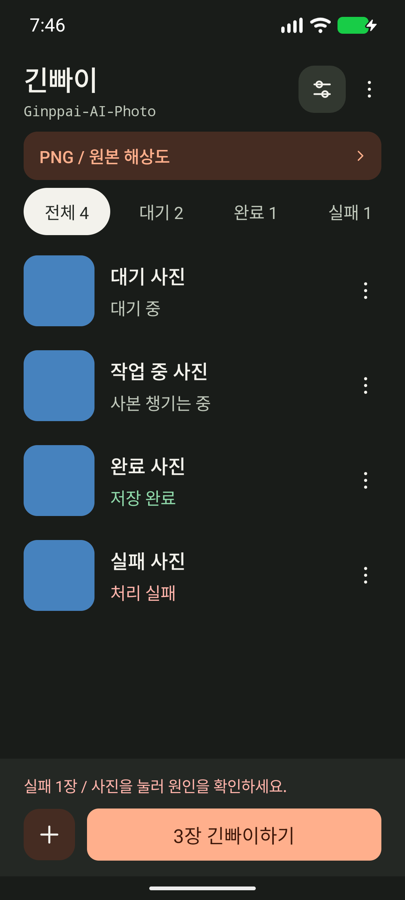

# Ginppai-AI-Photo

**사진만 쏙. 기록은 두고.**

사진에 딸려온 위치와 생성 기록은 빼고, 새 사본만 내 갤러리로 챙기는 Android 앱입니다. 먹색과 주황색, 가면 쓴 사진 아이콘에 긴빠이의 장난기를 담았습니다. 원본은 건드리지 않습니다. 계정, 광고, 구독, 서버 업로드와 처리 횟수 제한이 없습니다.

[최신 APK 다운로드](https://github.com/nogadamachine/Ginppai-AI-Photo/releases/latest) | [변경 내역](CHANGELOG.md)

<p>
  
  
  
</p>

1.6.0의 실제 Android 에뮬레이터 화면입니다. 목록 예시에는 합성 테스트 이미지만 사용했습니다.

## 설치와 업데이트

1. Releases에서 최신 APK를 받습니다.
2. Android에서 APK를 열어 설치합니다. 요청되면 APK를 연 앱에만 출처 허용을 설정하고 설치 후 다시 끌 수 있습니다.
3. 기존 버전은 삭제하지 않고 덮어 설치합니다. 패키지와 배포 서명을 유지하므로 작업 기록과 저장 형식을 유지합니다.

Android 10 이상이 필요합니다. Google Play 배포 앱이 아닌 직접 설치 APK입니다. 기기를 루팅하거나 보안 기능을 변경할 필요가 없습니다.

## 사용법

1. **사진 가져오기**로 한 장 또는 여러 장을 선택합니다. 갤러리의 공유 메뉴에서 이 앱으로 보내도 됩니다.
2. **저장 설정**에서 PNG 또는 JPEG를 고릅니다. 적용 버튼을 눌러야 변경 사항이 저장됩니다.
3. **긴빠이하기**를 누르면 한 장씩 처리하고 새 사본을 갤러리에 저장합니다.
4. 완료한 사진을 눌러 미리보기, 개별 공유 또는 다른 앱에서 열기를 사용합니다.

저장 위치는 `Pictures/Ginppai-AI-Photo`입니다. 전체, 대기, 완료와 실패 필터로 작업을 확인할 수 있습니다. 작업 목록을 비워도 원본과 갤러리의 사본은 삭제하지 않습니다.

## 저장 형식

| 형식 | 동작 |
| --- | --- |
| PNG, 기본값 | 원본 해상도로 저장하며 추가 손실 압축 없이 투명 배경을 유지합니다. 파일이 커질 수 있습니다. |
| JPEG | 화질 95로 압축하며 투명 배경은 흰색으로 바뀝니다. |

이미지를 기기 안에서 읽고 방향을 보정한 뒤 sRGB 새 파일로 저장합니다. EXIF, GPS, XMP, IPTC, C2PA와 프롬프트 등 원본 파일의 내부 기록을 복사하지 않습니다. 새 인코딩 결과에도 JPEG 마커 또는 PNG 청크 허용 목록을 적용하고 디코딩을 검사합니다.

JPEG, PNG, WebP, HEIC와 AVIF 등 기기 디코더가 읽을 수 있는 정지 이미지를 지원합니다. 동영상과 애니메이션은 지원하지 않습니다. 일부 HEIC 프로필, RAW와 손상된 파일은 읽지 못할 수 있습니다.

원본 ICC를 복사하지 않고 sRGB로 변환합니다. HDR, 광색역, 고비트 심도와 완전히 투명한 픽셀의 숨은 RGB까지 보존하는 보관 도구는 아닙니다. 원본 파일은 별도로 보관하세요.

## 개인정보와 권한

- 앱에 **인터넷 권한이 없습니다**. 사진과 사용 기록을 서버로 보내지 않습니다.
- 전체 사진 접근 권한 대신 Android 파일 선택기와 공유 권한을 사용합니다.
- 입력은 앱 내부 저장소에 임시 복사합니다. 처리 성공 또는 목록 제거 시 삭제하며, 실패하거나 대기 중이면 재시도를 위해 남습니다.
- 출력은 시스템 갤러리에 저장됩니다. Android가 관리하는 파일명과 새 저장 시각은 이미지 내부 기록과 별개입니다.
- 포그라운드 서비스, 알림과 처리 중 절전 방지 권한을 사용합니다. 시스템 백업은 비활성화했습니다.

## 기기 한계

사용 횟수와 하루 처리 장수에 인위적인 제한은 없습니다. 한 장씩 순차 처리하며 저장 공간과 메모리는 필요합니다.

- 입력 파일: 최대 256 MiB
- 한 변: 최대 32,768픽셀
- 화소 수: 최대 80,000,000픽셀
- 예상 작업 메모리: `min(384 MiB, 앱 최대 힙의 절반)` 이내
- 큰 이미지를 몰래 축소하지 않습니다. 처리할 수 없으면 이유를 표시합니다.
- Android 파일 선택기와 공유 대상 앱의 제한은 그대로 적용됩니다.

릴리스 APK는 빌드 시 10 MiB 이하인지 검사합니다. 설치 후 크기, 작업 메모리와 저장한 사진까지 이 크기로 제한하는 것은 아닙니다. 추가 모델 다운로드는 없습니다.

## 로컬 빌드와 테스트

JDK 17, Android SDK Platform 35와 Build Tools 35.0.0이 필요합니다. Gradle 8.11.1과 Android Gradle Plugin 8.9.2를 사용합니다.

```sh
export JAVA_HOME=/path/to/jdk-17
export ANDROID_HOME=/path/to/android-sdk
./gradlew assembleDebug assembleRelease lintRelease
```

- 디버그 APK: `app/build/outputs/apk/debug/app-debug.apk`
- 미서명 릴리스 APK: `app/build/outputs/apk/release/app-release-unsigned.apk`
- 첫 빌드는 공개 저장소에서 도구를 다운로드할 수 있습니다.
- 배포 서명 키와 비밀번호는 저장소에 없습니다. 직접 빌드한 디버그 APK는 배포 APK와 서명이 다릅니다.
- 자동 클라우드 빌드와 GitHub Actions는 사용하지 않습니다.

테스트는 합성 이미지와 별도의 에뮬레이터에서 실행합니다. 테스트 앱의 작업 목록을 초기화하므로 실제 사용 중인 기기에서 실행하지 마세요.

```sh
./gradlew connectedDebugAndroidTest
```

PNG 픽셀과 투명도, JPEG 방향, 메타데이터 제거, 여러 입력 형식, 잘못된 파일, 취소와 메모리 가드, 작업 복구, 일괄 저장, UI 필터 및 설정을 검사합니다. 실행 결과와 미검증 범위는 [검증 기록](docs/VALIDATION.md)에 정리합니다.

릴리스 파일의 SHA-256은 Releases의 `SHA256SUMS`를 참고하세요. 배포 서명 인증서 SHA-256은 다음과 같습니다.

```text
d12177695a23784e5907853e4ffecaf3dedf403c9016f36ad795c781e128e048
```
